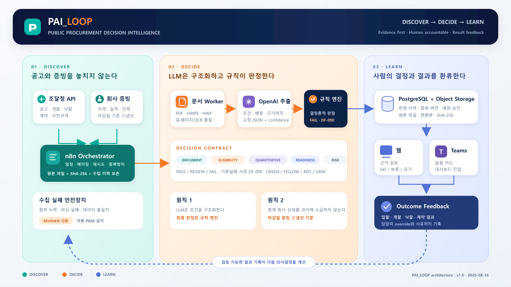

# PAI_LOOP

**Evidence-first public procurement decision intelligence**

PAI_LOOP는 조달 공고를 놓치지 않고, 공고 문서의 참가조건을 근거 위치와
함께 구조화한 뒤, **공고 마감일 당시 유효한 회사 증빙**과 비교하여 담당자의
입찰 의사결정을 돕는 시스템입니다.

LLM은 조건과 근거 후보를 구조화할 뿐입니다. 최종 적격성은 버전이 고정된
규칙 엔진이 `PASS / REVIEW / FAIL`로 판정하고, 실제 `GO / CONDITIONAL_GO /
HOLD / NO_GO`는 부서 담당자가 근거와 함께 기록합니다.



> 이 README는 저장소의 코드·`manifest.json`·workflow JSON 기준(2026-10-20 갱신)입니다.
> CI 통과나 `publish: true`는 운영 배포·활성화를 증명하지 않습니다. 실제 운영 상태는
> Cloud Run, n8n, PostgreSQL을 직접 조회해 별도로 확인합니다.

## 현재 구현 범위: v0.11.0

### 업무 화면 (로그인 필요)

업무 앱은 **부서 계정 로그인**이 있어야 데이터를 반환합니다. 상단 메뉴는 다음과 같습니다.

| 메뉴 | 하위 화면 | 주요 기능 |
|---|---|---|
| 오늘 할 일 | — | 부서별 공고 검토 현황, 우리 부서의 관심 공고, 업무 지표 |
| 공고 찾기 | 진행 공고 · 사전규격 찾기 | 저장 공고 검색과 나라장터 용역 공고/사전규격 직접 조회(투 트랙) |
| 입찰 검토 | 검토 대기 · 진행 건 · 결과 입력 · 담당자 판단 | 자격·정량·리스크 근거 확인과 부서별 판단 기록 |
| 입찰 결과 | 결과 기록 · 낙찰 결과 · 보관함 | 결과 학습 입력·수정, 회사별 낙찰 조회, 낙찰 실적 후보, 종료·취소 이력 |
| 회사 수행 실적 | — | 판정에 쓰는 회사 정보(읽기 전용), 운영 실적 등록·수정, 공개 실적 검색 |

공고 상세는 `요약 / 입찰 결과 / 주요 확인 사항 / 정량 점수·주의사항 / 최근 3년 낙찰 이력 /
Teams 알림 미리보기` 탭으로 구성됩니다.

- **저장 공고와 나라장터 검색 분리**: 저장 DB를 먼저 검색하고, 나라장터 용역 공고(게시일
  최대 31일)는 명시적 버튼으로만 조회합니다. 선택한 한 건만 서버에서 재검증해 저장하며,
  이렇게 저장한 공고는 자동 분석 큐에서 제외됩니다(`MANUAL_ONLY`).
- **사전규격**: 최근 최대 31일 용역 사전규격을 검색·저장하고, 명시적 승인 시 최대 5개 공식
  문서를 비동기로 분석합니다. 입찰공고나 GO 판정 큐와 분리됩니다.
- **수동 분석**: 유료 분석 권한(`paid_analysis_allowed`)이 있는 계정만 OPEN PPS 공고 1건을
  분석할 수 있습니다. 공고당 cooldown(기본 24시간)과 중복 요청 재사용을 적용하며, 시간당
  합계 한도는 `PAI_LOOP_PUBLIC_MANUAL_ANALYSIS_HOURLY_LIMIT`(기본 0 = 제한 없음)로 설정합니다.
  예전 4자리 운영 PIN은 폐기되어 어떤 경로도 인증하지 않습니다.
- **공고문 우선 읽기**: 첨부 중 공고문을 먼저 분석하고, 다른 문서로 뒤집을 수 없는 사실(업종
  코드, 본사·지사·교육시설 지역, 면허 미보유 등)로 부적격이 확정되면 나머지 첨부의 유료 호출을
  `SKIPPED_NOTICE_CONFIRMED_INELIGIBLE`로 생략합니다. 재시도 대상에는 적용하지 않습니다.
- **나라장터 업종·지역 제한 교차검증**: 공고의 참가 제한 정보를 별도로 수집해 추출 결과와
  대조합니다. 기존 판정 결과를 바꾸지 않는 보조 검증입니다.
- **진행 건 참여 부서**: 진행 중인 공고에 판단한 부서명과 판단 배지를 표시하고, 종료·취소를
  포함한 과거 참여 공고도 조회합니다. 다른 부서가 이미 입력한 결과는 `입력 완료 · 부서명`으로
  표시합니다.
- **결과 학습**: 종료 공고의 `NO_BID / SUBMITTED / WON / LOST / CANCELLED`, 투찰·낙찰금액,
  점수, 순위, 사유와 근거를 초안/검증/보관 상태로 입력합니다. 자동 환류 원본은 덮어쓰지 않고
  담당자 검토본을 별도 연결하며, 멱등 생성과 낙관적 동시성 검사를 적용합니다.
- **낙찰 실적 후보**: 회사별 낙찰 조회 결과 중 우리 회사 낙찰만 `실적 후보`로 저장하고
  숨김·복원할 수 있습니다. 후보는 회사 실적이나 정량 계산에 자동 반영되지 않습니다.
- **회사 실적**: 공개 비식별 seed와 분리된 운영 실적을 관리합니다. 계약기간·금액·VAT·완료·
  공동수급 지분·실적증명서·키워드와 근거를 기록하며, 정량 계산에는 `VALIDATED` 실적만 씁니다.

### 판단 엔진

- 참가요건을 `적격성 / 행동 필요 / 체크리스트 / 정보`로 분리하는 정책 엔진
- 마감일 기준 증빙 Gate와 `applicable PASS path → linked REVIEW → DF-000 default FAIL`
  해석. AND 경로의 명시적 필수 FAIL은 경로를 실패시키고, REVIEW가 다른 FAIL을 가리지 않습니다.
- 리뷰 코드 R01~R07, R09와 DF-000 설명 필드(`failed_condition`, `required_value`,
  `current_value`, `unmatched_pass_paths`, `review_not_matched_reason`) 보존
- 현재 PPS 첨부 manifest 전량 감사. 기대·감사·수용 첨부 집합이 다르면 분석 완료로 보지
  않습니다. HWP/HWPX 미지원·텍스트 없음은 문서 품질 REVIEW이며 자동 부적격이 아닙니다.
- 저장된 다중 첨부 추출본을 원자조건으로 병합한 뒤 평가·조건결과·정량·가격·경쟁리스크·
  부서추천·시스템 입찰의견을 한 트랜잭션의 불변 snapshot으로 저장
- 판정 기준이 바뀐 직후 재분석 전까지는 이전 충족·부적격 판정을 표시해 화면 공백을 막습니다.

### 부서 추천

- 부서 키워드 registry `src/pai_loop/data/department_keyword_profiles.json`
  (버전 `2026.10.13-1`, 24개 부서·센터). 부서별 `strong / supporting / excluded` 키워드와
  지역을 가집니다.
- 공통 수집어 `교육·컨설팅·연수·포럼·위탁 운영`과 부서 키워드를 결합해 검색 우선순위를 만들고,
  지역 Gate(`PAI_LOOP_REGION_GATE`, 기본 사용)로 4개 지역본부에 라우팅합니다.
- 역량솔루션본부는 자체 키워드 추천과 함께 지정 지역의 공동 라우팅 대상이 되며, 동점이면
  지역본부를 먼저 표시합니다. 규칙은
  [Department recommendation and region routing v0.6.0](docs/DEPARTMENT_KEYWORD_RANKING_v0.6.0.md)을 따릅니다.

### 리스크 표시

리스크 화면은 해당 평가의 `explanation.risk.axis_values`를 우선 사용하며, 6개 항목의
점수·계산 근거·가중치와 미산정 시 필요한 자료를 표시합니다. 부서 계정용 응답에는 허용된
숫자와 분류값만 전달하고 회사 사실값·증빙 식별자·자유형 내부 설명은 제외합니다.

총점은 기존의 4개 이상 근거 및 원문 검증 기준을 유지합니다. 경쟁 강도는 낙찰 이력 기반
추정치, 수익성은 예측 낙찰률 기반 가격 압박 보조지표이며 실제 이익률이 아닙니다.
원문 검증을 통과했으나 1~3개 항목만 산정된 경우에는
`참고 환산점수 = Σ(산정 점수 × 가중치) / Σ(산정 가중치)`를 표시합니다. 산정불가 항목은
분자·분모에서 모두 제외하며 0점이나 만점으로 채우지 않습니다. 이 참고값은 저장된 공식
총점·등급·입찰 판단을 바꾸지 않으며, 원문 검증 보류(`WITHHELD_R07`)나 근거가 전혀 없는
경우에는 표시하지 않습니다.

낙찰 이력은 동일 사업을 확정하는 데이터가 아니라 공고명 키워드로 조회하고 토큰 겹침과
한글 3-gram 유사도를 함께 보여주는 **검토용 후보 목록**입니다.

### 정량 규칙과 회사 사실의 안전 계약

정량 규칙의 원문 검증과 실제 회사값의 점수 적용은 별도 단계입니다. 현재 공고의
모든 첨부와 정확한 원문 인용, 표 총점, 겹치거나 빠지지 않는 배점 구간, 지원 단위와
산식을 기계 검증한 규칙은 `SOURCE_VALIDATED / AUTO_ACTIVE`가 되며 추가 사람 승인을
요구하지 않습니다.

`AUTO_ACTIVE`는 회사 점수가 자동으로 존재한다는 뜻이 아닙니다. 동적 평가항목마다
현재 문서 해시·표·항목·산식·단위를 묶은 `fact_binding_sha256`를 만들고, 마감일 기준
유효한 검증 증빙을 가진 canonical `CompanyFact`가 같은 binding digest를 명시할 때만
결정론적 점수를 계산합니다. 증빙 metadata의 `company_fact_payload_sha256`도 회사값·단위·
유효기간·출처의 canonical payload와 정확히 일치해야 합니다. 인정기간, 유사사업 범위,
단일계약/VAT/공동수급 지분, 인력 역할·경력처럼 문맥이 다른 generic 회사값은 재사용하지
않고 `UNSCORABLE`로 남깁니다. 회사 증빙이 없거나 binding이 다를 때 0점이나 만점을
임의로 추정하지 않습니다.

수행실적 금액·건수는 인정기간·유사범위·단일계약금액·VAT·완료·공동수급 지분·실적증명서
조건을 원문에서 구조화하고 운영자가 `VALIDATED`로 확정한 실적대장에 같은 조건을 적용할 수
있을 때만 자동 집계합니다. 조건 하나라도 불명확하면 `FACT_DIMENSIONS_UNMODELED /
REVIEW_REQUIRED` 또는 항목 `REVIEW`로 유지합니다. 정량 엔진은 연속 배점구간, 초과/이상/
미만/이하/같음 임계값, 단일 지표 비례 산식, 신용등급 등 명시적 범주표와 boolean 유형을
결정론적으로 계산합니다. 정성+가격만 있는 평가는 "회사 정량 항목 없음"으로 표시하고,
점수가 없는 공고는 그 사유를 함께 보여 줍니다.

### 공고 수명주기

PPS metadata의 제목·기관·금액·게시/마감·차수·상태·분류·안전한 원문 URL과 첨부
manifest는 material version을 만들지만, 검색어와 `provider_changed_at`은 동일 version의
비material provenance로만 합칩니다. 취소·필수필드 누락 최신 이벤트는 credential/raw
payload 없이 해시된 compact `pps_notice_authorities` 행으로 보존되며, 실행로그를 7일 뒤
삭제해도 유지됩니다. 따라서 이후 부분 검색에 나타난 낮은 차수·오래된 공고가 취소/연장
상태를 되돌릴 수 없습니다.

취소가 현재 authority이면 기존 공고와 분석·결정 이력은 읽기 전용 감사 이력으로 보존하고,
새 평가·담당자 결정은 차단하며 활성 업무 화면에서 제외합니다. 이후 더 최신의 유효한
연장·재등록이 authority를 차지하면 최신 공고만 다시 진행 상태가 됩니다. 수의·직접계약은
감사 보존하되 기본 진행목록과 분석 큐에서 제외합니다.

## 대시보드 집계

- 여섯 업무 지표의 비율은 페이지·검색 결과 수가 아닌 `/dashboard`의 전체 저장 공고 수를
  분모로 사용합니다. 지표끼리 중복될 수 있으므로 비율의 합이 100%를 뜻하지 않습니다.
- 로그인 부서를 기본 선택하되 다른 부서 현황도 조회할 수 있습니다. 추천 공고는 진행 중인
  비취소 공고의 키워드·지역 매칭이며, 선택 공고는 부서별 최신 `GO / CONDITIONAL_GO` 판단입니다.
- 집계가 없거나 분모가 0인 비율은 `—`로 표시합니다. 조회 실패 시 마지막 확인 시각을 함께
  표시하며 현재 페이지의 공고 수를 전체 수치로 대체하지 않습니다.

## 접근 제어와 계정

- 모든 요청은 `require_app_access`를 통과해야 합니다. 로그인 없이 열리는 경로는 `/healthz`,
  정적 자산, 데이터 없는 로그인 화면(프론트엔드 경로), 공개 소개 페이지 `/open`, 계정
  진입점(`/api/v1/accounts/{me,login,logout}`)과 Teams 봇 callback뿐입니다.
- 계정 기능은 `PAI_LOOP_DEPARTMENT_ACCOUNTS_ENABLED`로 켭니다(기본 false). 꺼져 있으면
  브라우저 API 요청은 401로 거절됩니다.
- 역할은 `ADMIN`(계정 관리)과 `DEPARTMENT`(자기 부서 판단·결과 작성) 두 가지이며, 유료
  분석은 계정별 `paid_analysis_allowed` 권한으로 별도 통제합니다. 관리자의 타 부서 대리 판단은
  허용하지 않습니다.
- 비밀번호는 scrypt로 저장하고, 세션은 httponly 쿠키 8시간, 쓰기는 same-origin + 세션 결합
  CSRF 토큰을 요구합니다. 로그인 실패는 15분 단위로 제한합니다.
- 서버 간 호출(n8n)은 `X-PAI-LOOP-API-KEY`를 쓰며, 브라우저로 보이는 요청에서는 403으로
  거절합니다. 비공개 실적·증빙 API는 별도 `X-PAI-Private-Evidence-Token`만 추가로 허용합니다.
- Entra SSO는 앱 로그인에 아직 연결되지 않았습니다(Teams 봇 토큰 검증에만 사용).
- `PAI_LOOP_PUBLIC_READ_ONLY`는 이제 익명 접근을 허용하지 않으며, 응답을 공개 안전 형태로
  축소하는 모드와 수동 분석 활성화 전제조건으로만 쓰입니다.

초기 관리자 활성화와 부서 계정 전환 절차는
[부서 로그인 전환 운영 안내](docs/ACCOUNT_LOGIN_CUTOVER.md)와
[Required login](docs/required-app-login.md)을 따릅니다.

## 공개 소개 페이지 `/open`

`/open`은 로그인 없이 열리는 정적 소개 페이지입니다. API를 호출하지 않으며(`connect-src
'none'`) 고정 허용 목록의 파일만 제공합니다. 첫 화면은 `광고영상`(기본)과 `기능 소개` 두 영상
탭이고, 아래에 8장면 스크롤 스토리가 이어집니다. 32 MiB를 넘는 미디어는 Cloud Run 응답
버퍼 한도를 피하도록 chunked 스트리밍(Range 포함)으로 제공합니다. 소스와 빌드 안내는
[`web/pai-open/README.md`](web/pai-open/README.md)에 있습니다.

## 빠른 로컬 실행

Python 3.11 이상이 필요합니다(CI는 3.12).

```powershell
python -m venv .venv
.\.venv\Scripts\Activate.ps1
python -m pip install -e ".[test]"
Copy-Item .env.example .env
$env:PAI_LOOP_SEED_SYNTHETIC="true"
uvicorn pai_loop.main:app --host 127.0.0.1 --port 8000
```

`http://127.0.0.1:8000/healthz`로 상태를, `http://127.0.0.1:8000/api/docs`로 현재 API
전체(OpenAPI)를 확인할 수 있습니다. 업무 화면의 데이터를 보려면
`PAI_LOOP_DEPARTMENT_ACCOUNTS_ENABLED=true`와 로컬 계정이 필요합니다. 서버 키로 API를
직접 호출하는 경우(브라우저가 아닌 클라이언트):

```powershell
$env:PAI_LOOP_API_KEY="local-placeholder-key"   # 서버 시작 전 설정
Invoke-RestMethod -Method Post -Uri http://127.0.0.1:8000/api/v1/ingestion/replay `
  -Headers @{ "X-PAI-LOOP-API-KEY" = $env:PAI_LOOP_API_KEY }
```

합성 fixture에는 `SYN-` 접두사를 사용하며 실제 회사정보나 개인정보를 포함하지 않습니다.

DB 관련 CLI:

| 명령 | 용도 |
|---|---|
| `pai-loop-migrate --create-base` | 새 DB 기본 스키마 생성 후 additive migration 적용 |
| `pai-loop-migrate --check` | 대기 중인 migration을 JSON으로 보고(있으면 exit 1) |
| `pai-loop-seed-public-notice --create-schema` | 공개 인천 공고 seed 멱등 적재 |
| `pai-loop-teams-followups` | 개인 Teams 관심 공고 알림 디스패처 |

기본 DB는 SQLite이며, 운영은 PostgreSQL(`.[postgres]`, `postgresql+psycopg`)만 허용합니다.
PostgreSQL 테스트는 반드시 일회용 DB에서만 실행하고 운영 DB를 가리키지 않습니다.

## 테스트

```bash
python -m pip install -e ".[test]"
python -m compileall -q src tests tools
python -m pytest --cov=pai_loop --cov-report=term-missing --cov-fail-under=85
```

`workflows/`, `manifest.json`, n8n 스크립트를 바꿨다면 추가로:

```bash
node --check scripts/deploy-workflows.mjs
node --check scripts/bind-claude-gateway-credentials.mjs
node scripts/deploy-workflows.mjs --validate-only
node scripts/bind-claude-gateway-credentials.mjs --self-test
node scripts/test-daily-workflow.mjs
node scripts/test-teams-delivery-workflow.mjs
node scripts/test-claude-gateway-workflow.mjs
node scripts/test-award-automation-workflow.mjs
```

CI(`.github/workflows/ci.yml`)는 PostgreSQL 16 서비스 위의 Python 테스트와 85% coverage
gate, wheel 내용 검사, 프론트엔드 자산 검사, n8n workflow 검증, 공개 저장소용 비밀값·원천
파일 스캔을 실행합니다.

## API 개요

전체 목록과 스키마는 실행 중인 서버의 `/api/docs`가 기준입니다. 주요 그룹은 다음과 같습니다.

| 그룹 | 대표 경로 | 비고 |
|---|---|---|
| 상태·프로필 | `GET /healthz`, `GET /api/v1/runtime-profile`, `GET /api/v1/dashboard` | |
| 계정 | `/api/v1/accounts/{me,login,logout}`, `PATCH /api/v1/accounts/{id}` | 세션·CSRF |
| 공고·근거 | `GET /api/v1/notices`, `GET /api/v1/notices/{notice_key}`, `.../analysis/requirement-policy`, `.../analysis-runs` | |
| 평가·판단 | `POST .../evaluate`, `/api/v1/operator-decisions`, `.../eligibility-confirmations` | 자기 부서만 작성 |
| 나라장터 조회 | `/api/v1/pps-discovery/{search,save}`, `/api/v1/prespec-discovery/{search,save}`, `/api/v1/pre-specifications` | 조회·저장 자체는 LLM 호출 0회 |
| 수동 분석 | `POST /api/v1/notices/{notice_key}/analysis/request` | 유료 권한 계정, cooldown |
| 낙찰·결과 | `/api/v1/company-awards/search`, `/api/v1/award-performance-candidates`, `/api/v1/notices/{notice_key}/award-intelligence`, `/api/v1/result-learning`, `/api/v1/outcome-feedback/pps/refresh` | |
| 회사 정보 | `/api/v1/company-profile`, `/api/v1/performance`, `/api/v1/performance-records` | |
| 운영(서버 키) | `/api/v1/operations/analysis-backfills/*`, `/api/v1/operations/award-refresh/*`, `/api/v1/operations/daily-briefing`, `/api/v1/operations/teams-daily-readiness`, `/api/v1/operations/retention` | n8n 전용 |
| 기준자료 | `/api/v1/reference-data/{versions,sync}` | 불변 버전 |
| Teams | `/api/v1/teams/*`, `/api/v1/teams/follows/*` | 개인 봇·관심 공고 |

## LLM 경로

- 운영(`PAI_LOOP_ENV=production`)은 `PAI_LOOP_LLM_PROVIDER=n8n_claude`만 허용합니다.
  추출 요청은 n8n W13 Claude gateway를 거치며, 모델은 `PAI_LOOP_CLAUDE_MODEL=claude-sonnet-5`로
  고정 검증됩니다. Anthropic credential은 n8n credential 저장소에만 둡니다.
- 운영 시작 시 `OPENAI_API_KEY`가 설정되어 있으면 기동을 거부합니다. 코드에 남은 `openai`
  이름의 파일·필드·카운터는 레거시 명칭이며 실제 OpenAI 호출을 뜻하지 않습니다. 개발 환경에서는
  provider 기본값이 아직 `openai`이므로, 로컬에서도 `.env.example`처럼 `n8n_claude`를 쓰는 것을
  권장합니다.
- LLM 출력은 신뢰하지 않는 구조화 추출이며 strict schema·원문 인용 재검증을 거칩니다. 단어
  사이 문장부호만 다른 인용은 원문 근거로 인정합니다. 긴 문서는 두 부분으로 나눠 추출합니다.

## n8n 자동화

`manifest.json`이 게시 허용 목록입니다. `publish: true`만 배포·활성화 대상이며, 00~04,
deployment smoke는 비활성 자산입니다. 아래 일정은 workflow JSON 기준이며 실제 활성 상태는
n8n에서 별도로 확인해야 합니다.

| Workflow | 계약 | 일정(KST) | 역할 |
|---|---|---|---|
| W10 Daily Opportunity Briefing | `daily-briefing-1.6` | 매일 07:30 | 최근 8개 calendar day 수집 → 신규·정정 key 전량 + 미분석 backlog 최대 50건을 DAILY 큐에 예약(실행당 5건, 1건 단위, 첨부 최대 10개) → 종료 공고 최종낙찰 최대 10건 환류 → 7일 로그 보관 → 브리핑 조립 |
| W11 Analysis Backfill | `analysis-backfill-1.2` | 매분 | 활성 큐를 DAILY 우선으로 재개(실행당 최대 30건, 동시 2건). 수동 실행 시 BACKFILL 큐 생성 |
| W12 Teams Daily Delivery | `teams-delivery-1.3` | 08:30~10:15, 15분 간격 | readiness가 `READY`/`READY_EMPTY`일 때만 저장 브리핑을 팀 채널에 1일 1회 전송 |
| W13 Claude Extraction Gateway | `claude-extraction-gateway-2.0-native-json` | webhook | Claude Messages API 호출 gateway. `promotionState=awaiting-native-live-e2e` |
| W14 Award History Automation | `award-refresh-automation-1.0` | 10분마다 | 저장 공고의 3년 낙찰 이력 갱신. AI 호출 0회, 배치 400초·일일 API 1,000건 예산 |

- W10은 공통 수집어와 부서 profile 키워드로 수집하고, 별도의 store-only 수집(추가 검색어·
  업종코드)으로 찾은 신규 공고는 `MANUAL_ONLY`로 저장만 합니다(`PAI_LOOP_STORE_ONLY_DISCOVERY=false`로
  끔). 낙찰 API만으로 참가를 증명할 수 없는 타사 낙찰은 `LOST`로 만들지 않습니다.
- 분석 1건 실패가 아침 브리핑 전체를 막지 않으며, 실패가 있어도 1건 이상 완료되면
  `DAILY_ANALYSIS_COMPLETE_WITH_FAILURES`로 전송 가능합니다.
- `PAI_LOOP_EMERGENCY_DISABLE=true`이면 모든 예약 gate가 fail-closed됩니다.
- `main` push/merge는 n8n workflow를 갱신하지 않습니다. 배포 절차는
  [n8n 수동 배포 운영 기준](docs/N8N_MANUAL_DEPLOYMENT_20260908.md)과
  [`deploy-n8n.yml`](.github/workflows/deploy-n8n.yml)의 수동 진입점을 따릅니다. backend HTTP
  노드는 n8n Generic Header Auth credential을 쓰며 workflow JSON에는 credential ID나 비밀값이
  없습니다.

## Teams 연동

- **팀 채널 브리핑**: W12가 Data Table `pai_loop_teams_delivery_config`의 승인·대상 설정과
  readiness를 모두 통과한 경우에만 전송합니다.
  [Teams 실제 전송 운영 가이드](docs/TEAMS_DELIVERY_RUNBOOK_v0.9.0.md)
- **개인 봇·관심 공고 알림**: 관심 등록 직후·마감 5일 전·마감일 오전에 개인 채팅으로 최신
  분석을 보냅니다(`PAI_TEAMS_FOLLOWUPS_ENABLED`).
  [개인 관심 공고 알림](docs/TEAMS_PERSONAL_FOLLOWUPS.md)
- **개인 데일리 브리핑**: readiness 확인 후 기본 08:30 KST에 개인 채팅으로 보냅니다
  (`PAI_TEAMS_BRIEFING_ENABLED`). [개인 Teams 데일리 브리핑](docs/TEAMS_DAILY_BRIEFING_DM.md)
- **Teams 탭**: `teams-app/PAI-LOOP-Teams-App.zip`으로 웹 앱을 Teams 탭 iframe으로 실행합니다.
  [Teams Custom Tab 가이드](docs/TEAMS_CUSTOM_TAB.md)

알림 기능은 봇 등록·개인 연결·상시 실행 환경이 갖춰져야 하며, 설정 없이 켜면 서버가 기동을
거부합니다.

## 배포

- 운영 앱은 **Google Cloud Run**에서 단일 컨테이너(FastAPI + SPA)로 실행되며, 저장소의
  `main` 반영을 Cloud Build trigger가 배포합니다. trigger 설정은 저장소 밖에 있습니다.
- 컨테이너는 시작 시 `pai-loop-migrate --create-base` → 공개 공고 seed 적재 → uvicorn 순으로
  실행합니다([`Dockerfile`](Dockerfile)).
- 앱은 `frame-ancestors`로 Teams(`*.teams.microsoft.com`, `*.cloud.microsoft`)와
  `aiedu.kma.or.kr`의 iframe 표시만 허용합니다.
- [`render.yaml`](render.yaml)은 이전 Render 데모 선언으로 남아 있습니다. 일부 문서·주석의
  "Render" 표기는 현재 Cloud Run 앱을 가리키는 과거 명칭입니다.

## 보안 경계

- `.env`, `secrets.txt`, API 키, webhook URL, 실제 첨부, 내부 데이터행, 전체 추출문은 Git에
  올리지 않습니다. CI가 비밀값 패턴과 원천 파일 확장자를 스캔합니다.
- 낙찰 후보에는 공고번호·공고명·발주기관·낙찰 법인명·참가 수·금액·낙찰률·개찰/낙찰일과
  유사도만 저장합니다. 사업자번호·대표자·주소·전화·담당자는 정규화 경계에서 폐기합니다.
- 공개 GitHub에는 공개 조달공고, 비식별화한 공개 실적, 파생 회사 자격 facts와 합성 회귀
  fixture만 둡니다. 사내 원천 어댑터와 원천 파일은 저장소·배포 패키지의 구성요소가 아닙니다.
- 공개 API 응답에는 raw payload, 내부 digest, provider metadata, 비공개 증빙을 노출하지 않습니다.
- 이 시스템은 실제 입찰 자격이나 법률 판단을 대신하지 않습니다.

자세한 기준은 [Security and privacy v0.2.0](docs/SECURITY_AND_PRIVACY_v0.2.0.md)을 참조하세요.

## 문서

현재 기준:

- [Product blueprint](docs/PRODUCT_BLUEPRINT_v0.1.0.md)
- [n8n workflow contracts](docs/architecture/N8N_WORKFLOWS.md)
- [Analysis backfill and continuation](docs/ANALYSIS_BACKFILL_AND_CONTINUATION_v0.8.0.md)
- [Award history automation (W14)](docs/AWARD_AUTOMATION_v0.1.0.md)
- [Native Anthropic gateway (W13)](docs/NATIVE_ANTHROPIC_GATEWAY.md)
- [Claude Sonnet 5 migration runbook](docs/CLAUDE_SONNET5_MIGRATION_RUNBOOK_v0.11.1.md)
- [Department recommendation and region routing v0.6.0](docs/DEPARTMENT_KEYWORD_RANKING_v0.6.0.md)
- [Quantitative scoring v0.3.0](docs/QUANTITATIVE_SCORING_v0.3.0.md)
- [Award and pricing intelligence v0.3.0](docs/PPS_AWARD_INTELLIGENCE_v0.3.0.md)
- [Competition and concentration risk v0.4.0](docs/PPS_AWARD_COMPETITION_RISK_v0.4.0.md)
- [PPS pre-spec discovery v0.9.0](docs/PPS_PRESPEC_DISCOVERY_v0.9.0.md)
- [Company public profile and requirement policy v0.3.0](docs/COMPANY_PUBLIC_PROFILE_AND_REQUIREMENT_POLICY_v0.3.0.md)
- [Analysis persistence and migrations v0.6.0](docs/DATA_PERSISTENCE_AND_MIGRATIONS_v0.6.0.md)
- [Search filter links](docs/NOTICE_FILTER_LINKS.md)
- [Architecture source](docs/architecture/README.md)
- [Public data source register v0.3.0](docs/SOURCE_REGISTER_v0.3.0.md)

`docs/runbooks/`와 날짜가 붙은 문서는 당시 작업 기록입니다. 일부 문서(예: OpenAI 추출 계약,
v0.4~v0.7 브리핑 runbook, 배포 전략 v0.1~v0.2)는 이후 구현으로 대체되었으므로 현재 동작은
코드와 위 문서를 기준으로 확인하세요.
